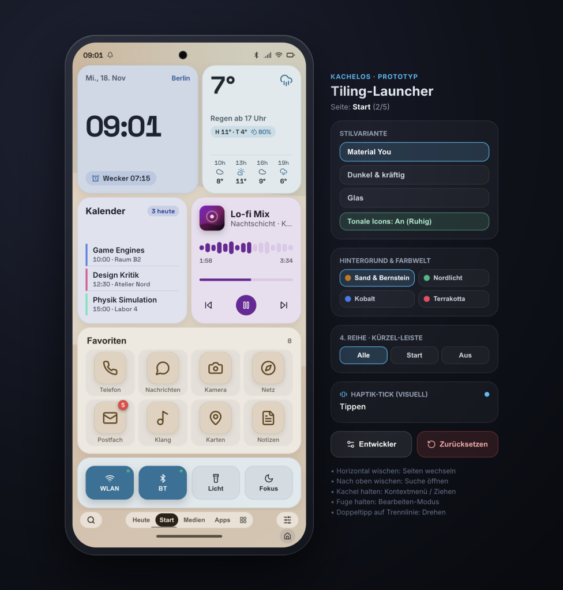
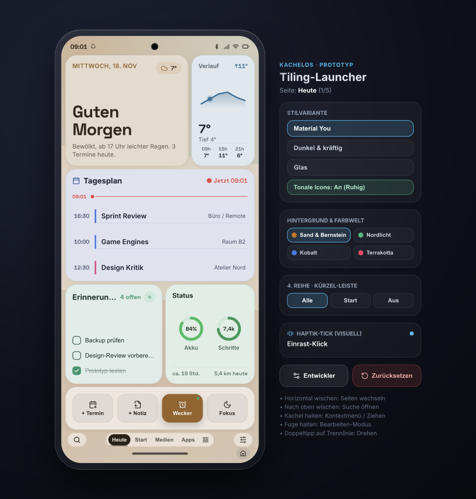
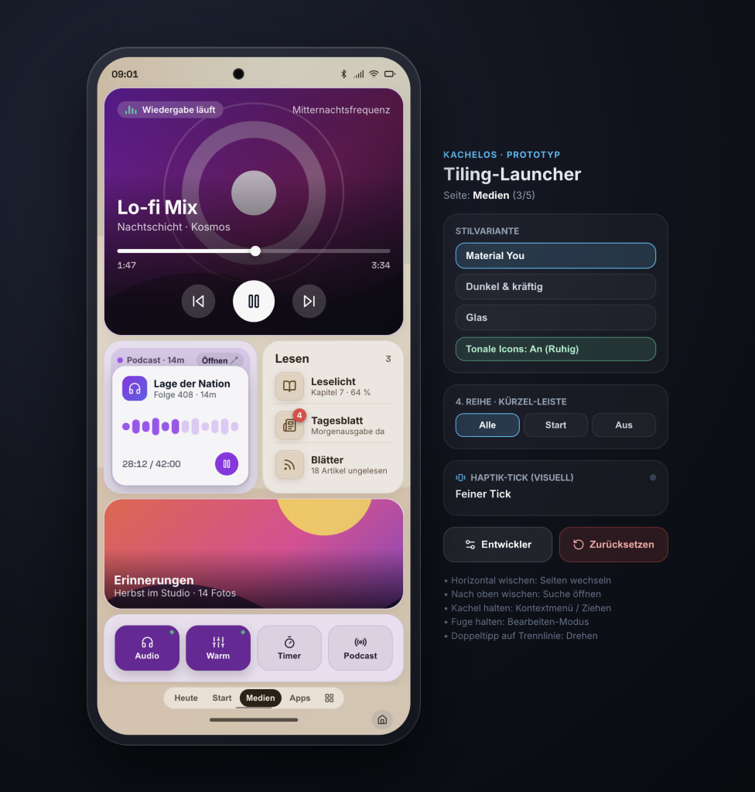
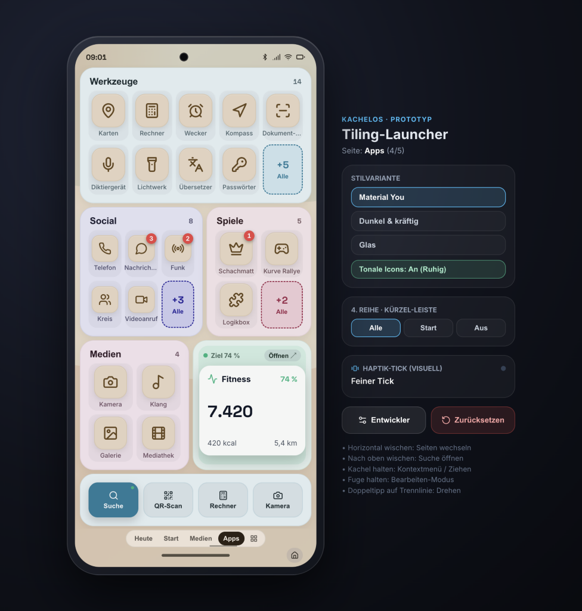
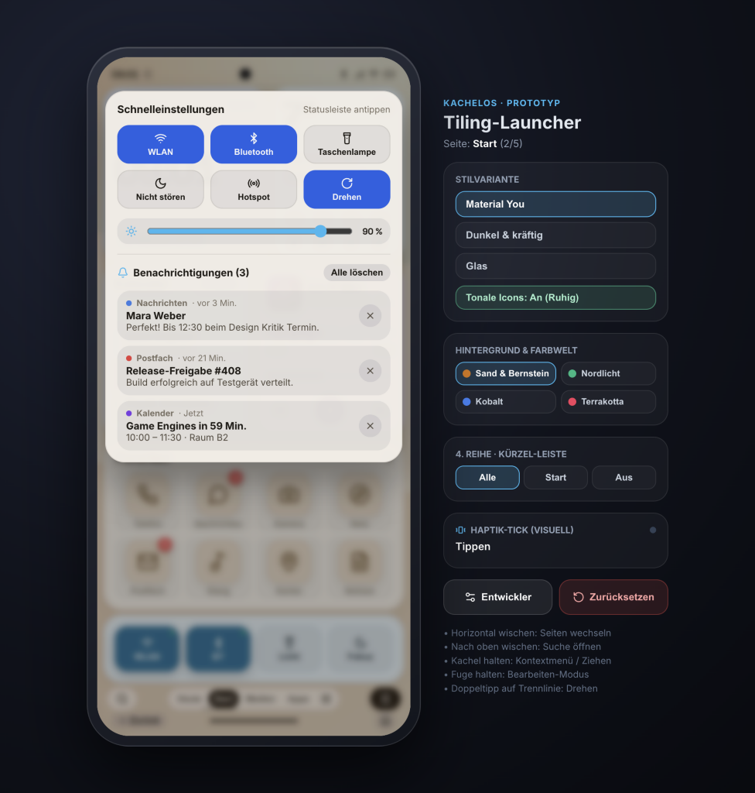
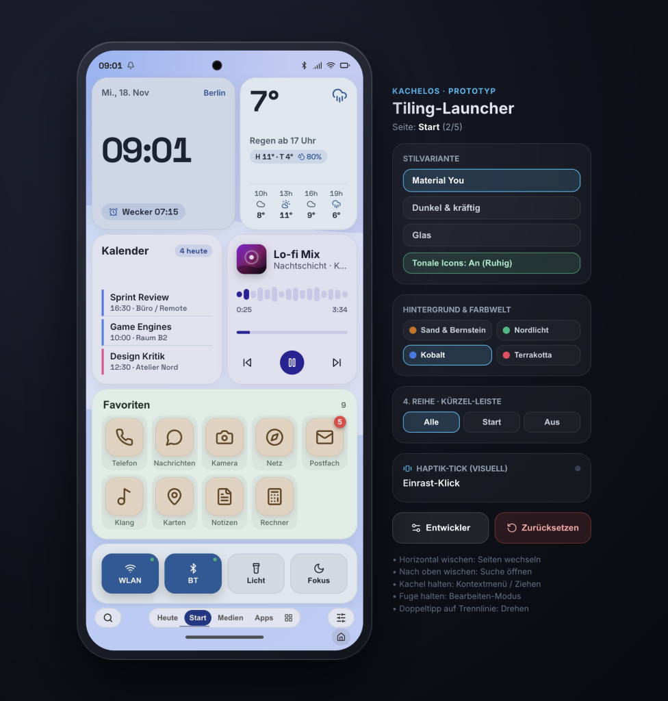

# Canopy – Android Tiling Launcher

**Canopy** ist ein neuartiger Android-Launcher, bei dem jede Startseite den Bildschirm **lückenlos über einen binären Teilungsbaum (Tiling Window Manager)** mit adaptiven Kacheln füllt – ganz ohne Rasterzellen, tote Ränder oder frei schwebende App-Icons.

Dieses Repository enthält die **native Android-Implementierung in Kotlin + Jetpack Compose (`app/`)**, die **vollständige technische Spezifikation** (`docs/SPECIFICATION.md`) sowie den **interaktiven Web-Prototypen** (`mockups/web-prototype/`) als lebendige Referenz für Layout-Engine, Design und Gestenphysik.

---

## Visuelle Referenz (Live-Screenshots aus dem Prototyp)

| Startseite (`Start`) | Tagesüberblick (`Heute`) | Medien-Seite (`Medien`) |
| :---: | :---: | :---: |
|  |  |  |

| Bento-App-Gruppen (`Apps`) | Quick-Settings & Mitteilungen | Farbwelt „Kobalt“ & Live-Sync |
| :---: | :---: | :---: |
|  |  |  |

---

## Kernfunktionen im Überblick

- **Binärer Tiling-Baum:** Jede Seite speichert Kacheln in einem `SplitNode`/`LeafNode`-Baum mit `6 dp` Fugen im Normalbetrieb und `12 dp` im Bearbeiten-Modus.
- **Bearbeiten-Modus direkt am Gerät:** 1D-Trennlinien und 2D-Kreuzungspunkte ziehen (Einrasten auf `¼, ⅓, ½, ⅔, ¾` per projizierter Geschwindigkeit, `56 dp`-Minimum mit `30 %` Gummiband), Doppeltipp dreht die Teilung, Drag & Drop tauscht/teilt über Kanten, Herauswerfen mit `5s Rückgängig`, Layout-Vorlagen und Kachel-Katalog.
- **Adaptive Kachel-Größenstufen (`XS`, `S`, `M`, `L`, `TICKER`, `LIST`):** Jede Kachel passt Darstellung und Typografie mit `8 dp` Hysterese fließend an ihre Größe an.
- **Symmetrische Bento-Gruppen & Live-Editor:** Dynamische Icon-Skalierung, `+N Alle`-Overflow, Vollbild-Gruppen-Overlay mit Inline-Umbenennung und `Apps +/−`-Verwaltung.
- **System-Integrationen im Prototyp erlebbar:** Pull-Down Schnelleinstellungen + wegwischbare Benachrichtigungen mit Live-Badge-Synchronisation, Universal-Suche (inkl. direktem Browser-Sprung per `Enter`), kontextuelle 4. Kürzel-Reihe (`Alle | Start | Aus`) und dreiteiliges Bottom-Dock.
- **3 Stilvarianten & 4 Farbwelten:** `Material You`, `Dunkel & kräftig`, `Glas` kombiniert mit `Sand & Bernstein`, `Nordlicht`, `Kobalt` und `Terrakotta`.

---

## Native Android-App bauen & testen (Kotlin + Jetpack Compose)

Die native Android-Umsetzung (`app.canopy.launcher`, `minSdk = 26`, `targetSdk = 35`) deklariert `CanopyLauncherActivity` als System-Launcher (`HOME` / `DEFAULT`) sowie optional `CanopyNotificationListenerService` für Live-Benachrichtigungs-Badges:

```bash
./gradlew testDebugUnitTest assembleDebug --no-daemon
```

* Unit-Tests: **67 JVM-Tests** über alle 18 Test-Suiten in `app/src/test/java/app/canopy/launcher/` (Tiling-Geometrie, Snap-Physik, Hysterese, Bento-Grid, Themen, Gesten, Drag & Drop, Suche, Badges & Widgets).
* Debug-APK: `app/build/outputs/apk/debug/app-debug.apk` (z. B. per `adb install -r app/build/outputs/apk/debug/app-debug.apk` installierbar).

---

## Interaktiven Referenz-Prototyp lokal starten

Der Web-Prototyp unter [`mockups/web-prototype/`](mockups/web-prototype) basiert auf **React 18 + TypeScript + Vite + Framer Motion + @use-gesture/react**:

```bash
cd mockups/web-prototype
npm install
npm run dev
```

* Läuft am Desktop im `390 × 844`-Smartphone-Rahmen inklusive Entwicklermenü (Feder-Tuning, Slow-Motion, visueller Haptik-HUD).
* Auf mobilen Bildschirmen (`< 500 px` Breite) automatischer **Vollbildmodus** mit echten `navigator.vibrate()`-Haptikmustern (`host: true` für Tests über das lokale WLAN).

### Unit-Tests der Tiling-Engine ausführen

```bash
cd mockups/web-prototype
npx vitest run
```

---

## Projektstruktur & Dokumentation

- [`app/src/main/java/app/canopy/launcher/`](app/src/main/java/app/canopy/launcher) – Native Android-Implementierung (Kotlin + Jetpack Compose, Tiling-Engine, Kacheln, Gesten, Systemintegration)
- [`app/src/test/java/app/canopy/launcher/`](app/src/test/java/app/canopy/launcher) – Native JVM-Unit-Tests für Layout-Engine, UI-Logik, Gesten & Systemintegration
- [`docs/SPECIFICATION.md`](docs/SPECIFICATION.md) – Vollständige Architektur-, Geometrie-, Motion- & UI-Spezifikation
- [`docs/screenshots/`](docs/screenshots) – Aktuelle UI-Referenz-Screenshots aller Kernansichten
- [`mockups/web-prototype/src/layout/`](mockups/web-prototype/src/layout) – Reine TypeScript Tiling-Baum-Engine + Unit-Tests (`tree.ts`, `tree.test.ts`, `types.ts`)
- [`mockups/web-prototype/src/tiles/`](mockups/web-prototype/src/tiles) – Alle Kacheltypen mit adaptiven Größenstufen
- [`mockups/web-prototype/src/motion/`](mockups/web-prototype/src/motion) – Zentrale Feder-Tokens & Haptik-Profile
- [`mockups/web-prototype/src/theme/`](mockups/web-prototype/src/theme) – Stilvarianten, Farbwelten & Parallax-Wallpaper

---

## Roadmap (Meilensteine)

Alle **6 Meilensteine (`M1`–`M6`, Issues `#1`–`#18`)** der nativen Android-Umsetzung sind abgeschlossen:

1. ✅ **M1:** Architektur & Tiling-Baum-Engine (Core Foundation) – `#1`–`#3`
2. ✅ **M2:** Design-System, Themes & Adaptive Kachel-Typen – `#4`–`#6`
3. ✅ **M3:** Seiten-Architektur (Heute, Start, Medien, Apps, Alle Apps) – `#7`–`#9`
4. ✅ **M4:** Gesten-Navigation, Feder-Physik, Haptik & Bottom-Dock – `#10`–`#12`
5. ✅ **M5:** Interaktiver Bearbeiten-Modus (1D/2D-Teiler, Drag & Drop, Vorlagen) – `#13`–`#15`
6. ✅ **M6:** Android-Systemintegration, Widgets, Suche & Release-Polishing – `#16`–`#18`
